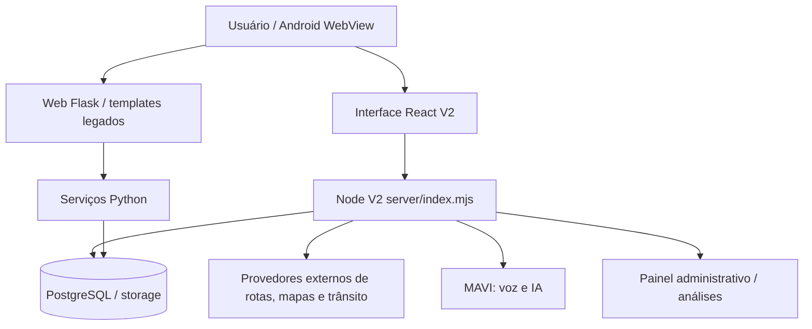

# Arquitetura — visão geral

## Diagrama de contexto

**Nota:** o gráfico é estrutural, não prova que todo endpoint ou integração esteja ativo no deploy. Confirmar por código, variáveis de ambiente e runtime.

## Fluxo de navegação V2

O React inicia em `v2/src/main.jsx`, compõe telas `pages/` e `components/`, e utiliza utilitários em `lib/`. O servidor `v2/server/index.mjs` é o ponto de entrada HTTP, delegando rotas, tráfego, radar, buscas, contexto, voz e armazenamento a módulos `.mjs` independentes. A configuração de deploy determina qual stack inicia em produção.

## Limites críticos

- Chaves e tokens pertencem às variáveis de ambiente do Render, nunca a commits.
- Mapas e tráfego são dependências externas; implementar fallback e tratar limites.
- Os módulos de rota e câmera exigem testes de regressão antes de qualquer remoção.
- `static/` e `templates/` podem atender caminhos legados.
- `v2/src/vNN-*.css` podem parecer versões antigas, mas podem estar importados pela UI.
- Licenças, migrações, documentação de contratos e testes não são lixo.

## Mapa de módulos

| Subsistema | Caminho | Papel |
|---|---|---|
| Aplicação Python | `app.py, vano/, db_backend.py, mobile_routes.py` | Flask: composição, rotas HTTP, autenticação, segurança, consultas e integrações legadas |
| Serviços Python | `vano/services/, vano_ai_routing.py, vano_radars.py, vano_osint_bridge.py` | Lógica de rotas, provedores geográficos, radar e contexto |
| Interface V2 | `v2/src/main.jsx, v2/src/pages/, v2/src/components/, v2/src/lib/, v2/src/config/` | React: boot, páginas, componentes, estado e utilitários de navegação |
| Estilos | `v2/src/*.css, v2/src/components/` | Estilos por recurso/época; nomes versionados ainda têm dependências e NÃO devem ser excluídos sem auditoria de importações |
| API V2 | `v2/server/index.mjs, v2/server/*.mjs` | Node: endpoints, rotas, dados de trânsito, APIs de mapas, MAVI, autenticação e armazenamento |
| Dados e banco | `v2/data/, v2/sql/, v2/server/storage*.mjs` | Catálogos, esquemas e persistência; migrações e contratos exigem preservação |
| Android | `android-vanu/, android-webview/` | Pacotes Android e WebView; não são duplicatas automaticamente |
| Infraestrutura | `render.yaml, Dockerfile.vano-v2, cloudflare/, .github/, v2/deploy/` | Deploy, edge, CI e infraestrutura |
| Web antiga | `static/, templates/` | Arquivos e templates Flask ainda referenciados; manter até verificar substituição |
| Qualidade | `tests/, v2/server/*.test.mjs, v2/src/lib/*.test.mjs, v2/scripts/` | Testes e scripts de regressão |
